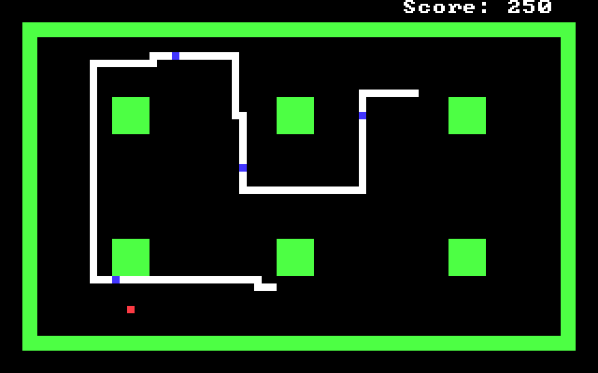
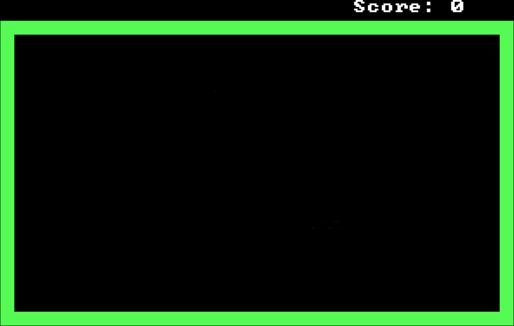
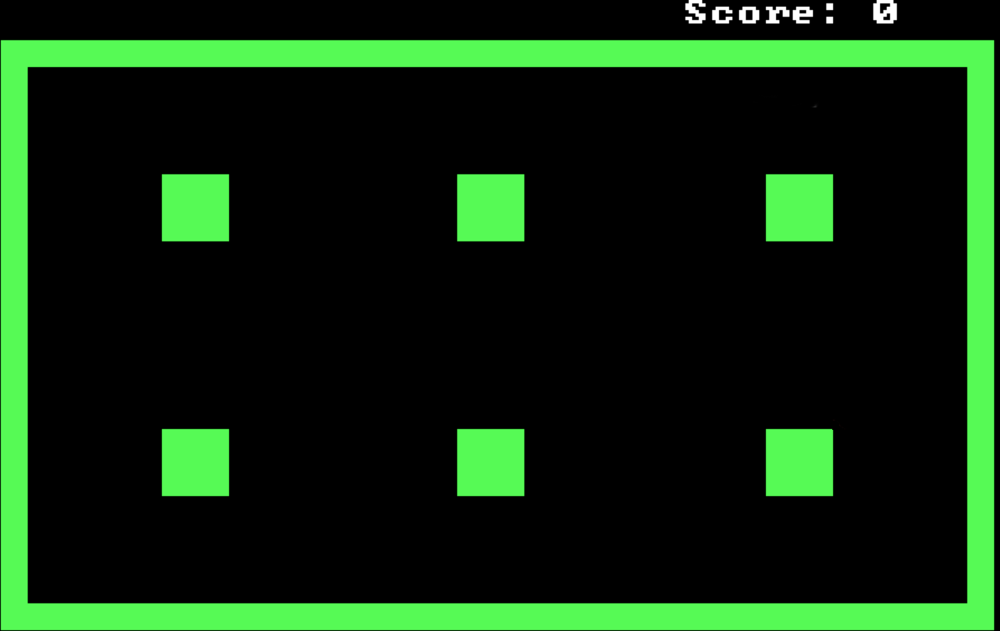
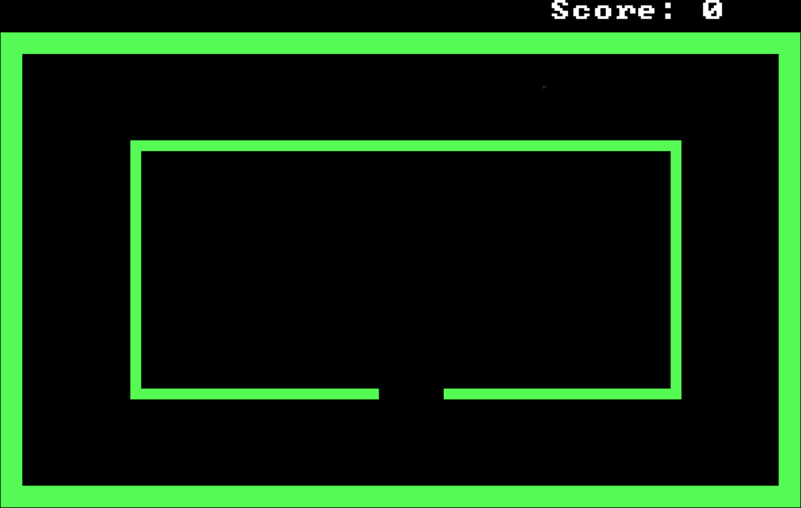
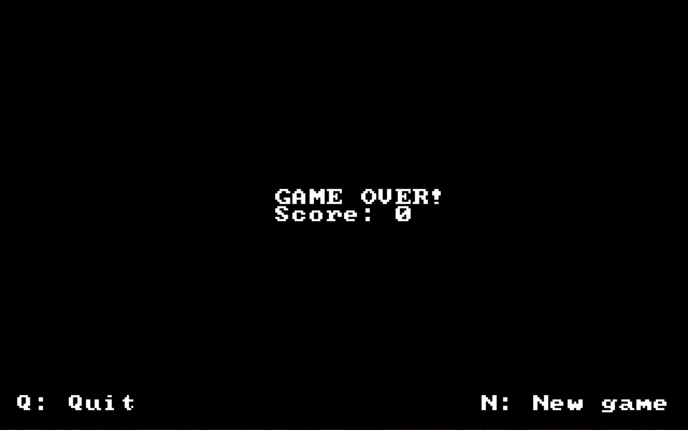
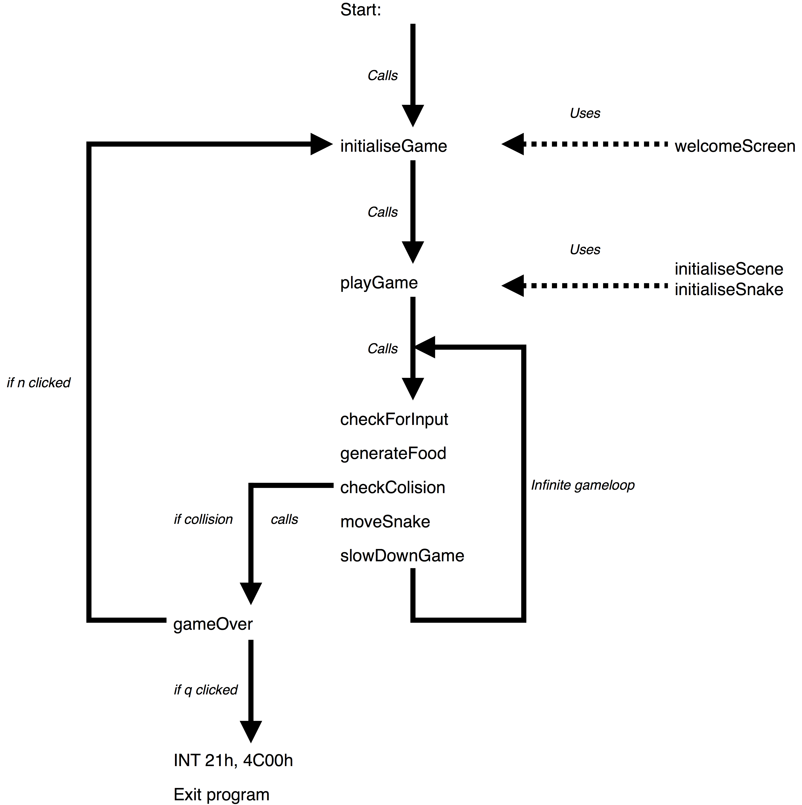
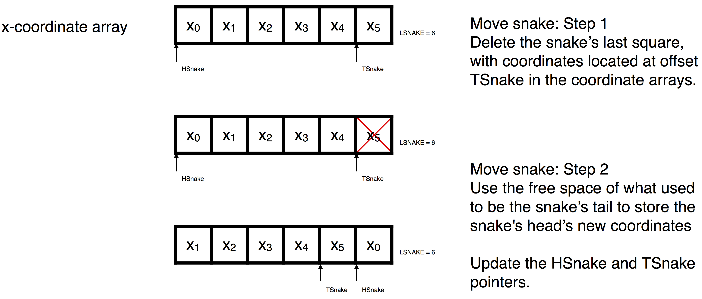
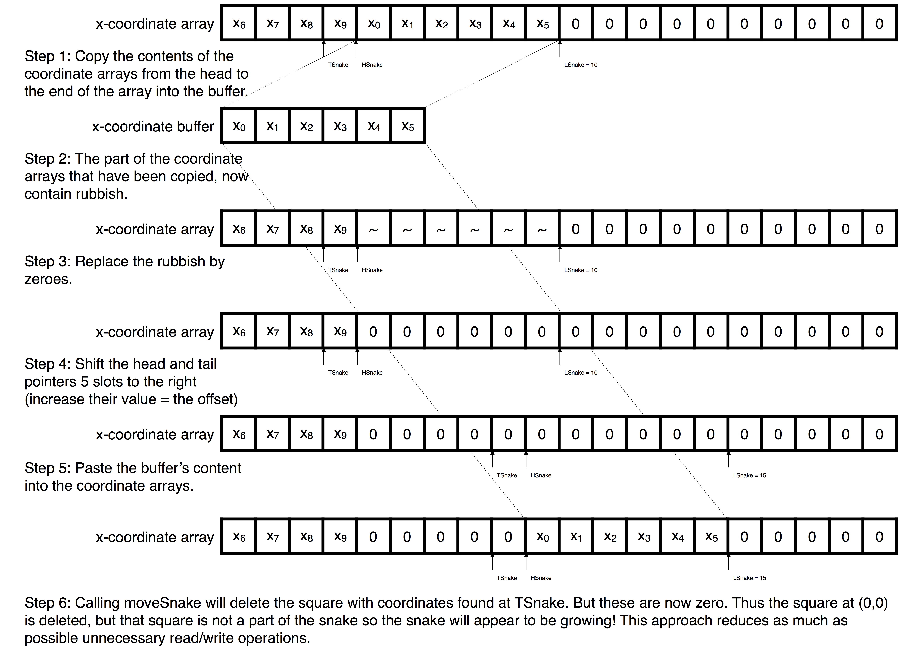
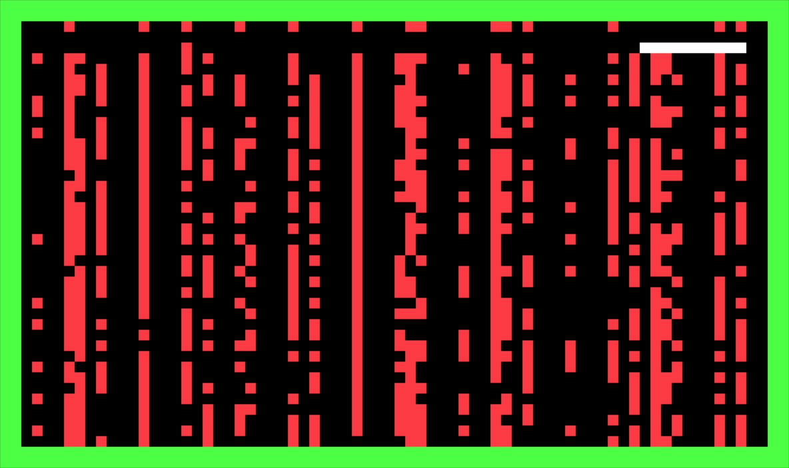
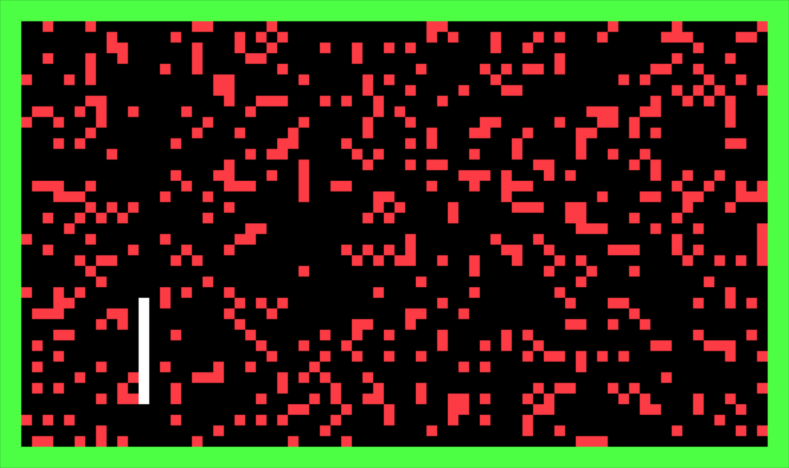

# VUB Snake

A clone of the classic Snake game, written entirely in 32-bit x86 assembly in 2016 for the Computersystemen course at the Vrije Universiteit Brussel (VUB). It runs under DOS in protected mode and draws directly to VGA memory (320×200, 256 colours).



## What it does

- **Level select:** pick one of three fields at start-up by pressing 1, 2 or 3.
- **Gameplay:** steer the snake with the arrow keys, pause with P and quit with Q. Each piece of red food makes the snake grow by 5 blocks. Swallowed food shows up blue as it moves down the body.
- **Difficulty:** the snake speeds up once the score reaches 100, 250 and 500.
- **Game over:** crashing into a wall, an obstacle or your own tail ends the game. From there you can quit (Q) or start a new game (N).

| Classic | Checkboard | The Cage |
|---|---|---|
|  |  |  |



## How it works

The full write-up is in [Project.pdf](Project.pdf). In short:

- `SNAKE.ASM` holds the game loop and all game logic. The settings at the top of the file (field size, colours, start position, speed, growth) can be tweaked.
- `HELPERS.ASM` contains small video-mode and screen helpers.
- `RAND.ASM` is a linear congruential random number generator by Tim Bruylants, supplied with the course and used to place food.

The snake is stored as x and y coordinate arrays with head and tail offsets that move through them, so moving the snake costs the same number of memory operations however long it gets. To grow, empty slots are inserted between the tail and the head. The game is timed by waiting for the VGA vertical retrace (60 Hz).

| Program structure | moveSnake |
|---|---|
|  |  |



Food placement first used the system clock squared, which clustered food in columns (left). The linear congruential generator spreads it evenly (right):

| Clock-based | Linear congruential |
|---|---|
|  |  |

## Running it

Requires [Open Watcom](https://github.com/open-watcom/open-watcom-v2) (`wasm`, `wlink`, `wmake`) and a DOS environment such as [DOSBox](https://www.dosbox.com/).

```sh
wmake
SNAKE.EXE
```

`wmake clean` removes the build output, and `wmake debug` starts the Watcom debugger.

## License

BSD 3-Clause, see [LICENSE](LICENSE). `RAND.ASM` and `RAND.INC` are copyright (c) 2015 Tim Bruylants under their own BSD 3-Clause license, included in those files.
